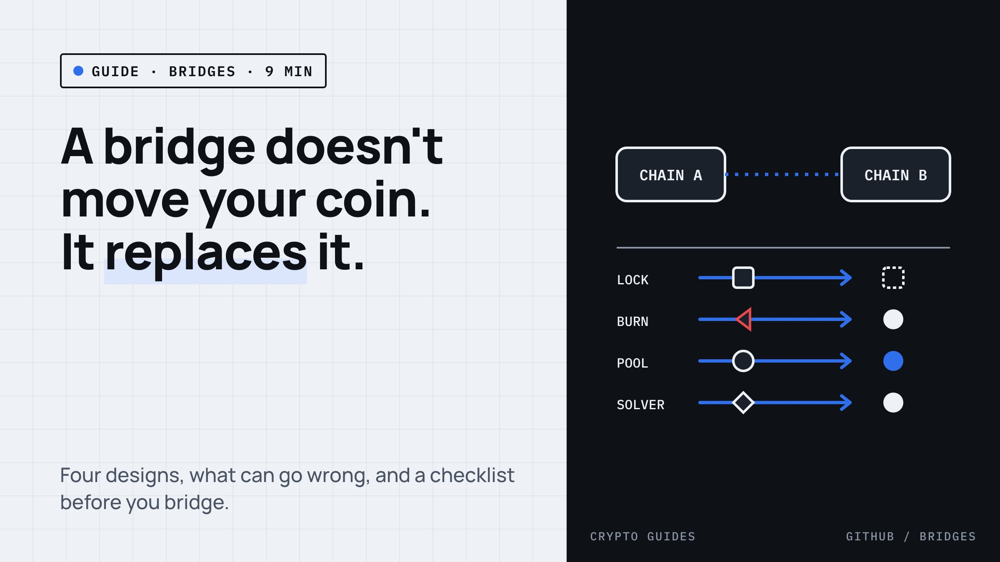
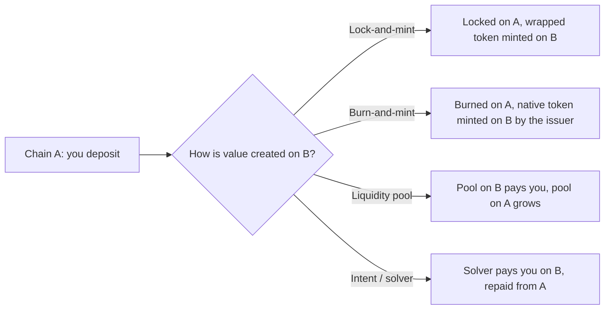
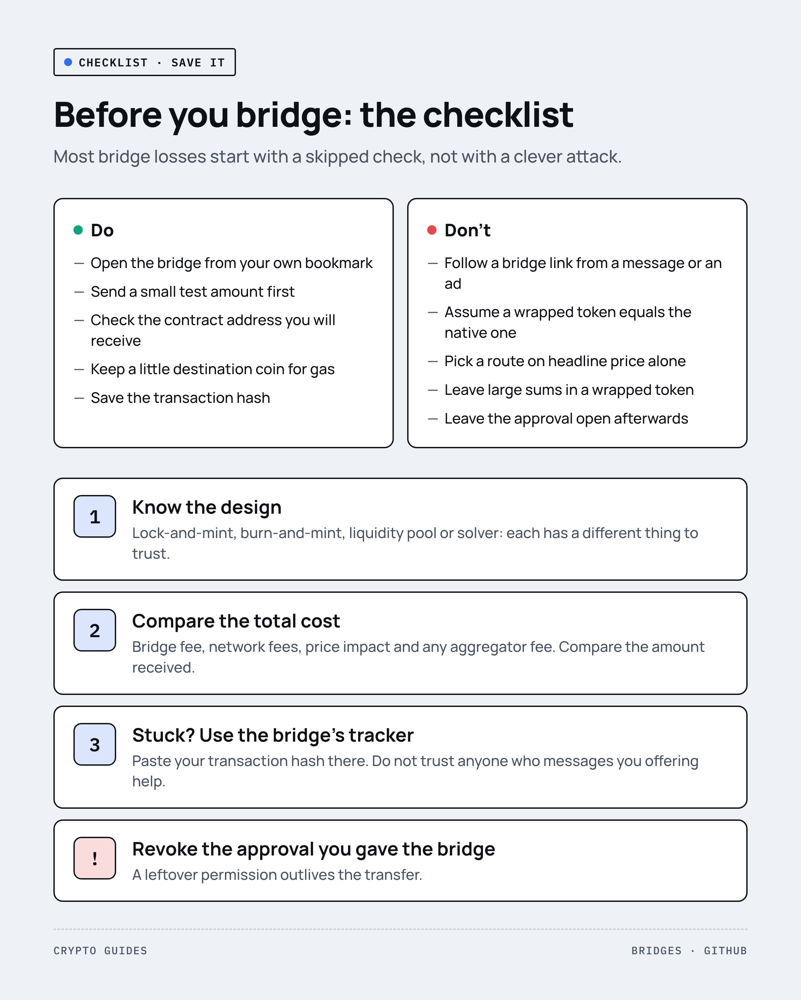

# How cross-chain bridges work, and how not to lose money using one

**A bridge does not move a coin between chains. It locks, burns, matches or fronts value on one side and creates or releases it on the other. Knowing which one tells you where the risk is.**

## Contents

- [Why bridges exist](#why-bridges-exist)
- [Four designs](#four-designs)
- [Wrapped versus native tokens](#wrapped-versus-native-tokens)
- [How aggregators route your transfer](#how-aggregators-route-your-transfer)
- [What can go wrong](#what-can-go-wrong)
- [Pre-bridge checklist](#pre-bridge-checklist)
- [Sources](#sources)

## Why bridges exist

Blockchains cannot read each other. Ethereum has no way to check directly what happened on Solana, or the reverse. Yet people
want their money on the network where fees are low or the app they need lives. A bridge is the extra system that
convinces the destination chain that "something happened" on the source chain, so value can appear there.

Most things sold as "moving a coin" are one of four patterns. They differ in who you have to trust and what can fail.

## Four designs

| Design | What happens | Example families | Main thing to trust |
|---|---|---|---|
| Lock-and-mint | Tokens are locked in a contract on chain A; a wrapped token is minted on chain B | Many classic bridges | The contract holding the locked funds and whoever approves the mint |
| Burn-and-mint | The token is burned on chain A, the same issuer mints fresh tokens on chain B | Circle's CCTP for USDC | The token issuer and the attestation service |
| Liquidity network | Pools of tokens sit on both chains; you deposit on A and receive from a pool on B | Pool-based bridges | Pool contracts and the messaging layer |
| Intent / solver | You state what you want ("USDC on Base"); a competing solver pays you on B, then is repaid from your deposit on A | Across and other intent-based systems; the ERC-7683 standard | The settlement contract and the verification of fills |

### Lock-and-mint

You send tokens to a vault on the source chain. Something (validators, a multisig, a light client, an oracle) tells the destination
chain to mint a matching **wrapped** token. To go back, the wrapped token is burned and the vault releases the original.
The weak point is the vault: all the locked funds sit in one place, and whoever can forge the "mint" message can mint tokens that are not backed.

### Burn-and-mint (for example CCTP)

Circle's Cross-Chain Transfer Protocol burns USDC on the source chain, and Circle's attestation service
signs a message that lets the destination chain mint the same amount of native USDC. There is no vault of locked
tokens and no wrapped version: the USDC you receive is the issuer's own token. The limitation is that it works only for the issuer's own token
and on the chains the issuer supports.

### Liquidity networks

Operators provide liquidity on each chain. You deposit on A and are paid from the pool on B. Prices and limits depend on pool depth:
big transfers on a thin route can cost more or be refused. Pool depth is also what makes transfers fast.

### Intent and solver bridges

You sign an order saying what you want to end up with. Independent **solvers** (relayers) fill it from their own funds on the destination
chain, usually within seconds, and are reimbursed from your deposit after the fill is verified. For you it feels fast;
the protocol's risk is about how fills are verified and how the deposits are settled. Across is one example, and
[ERC-7683](https://www.erc7683.org/) is an effort to standardise cross-chain orders.

Under the hood: how does chain B know about chain A?

The central question of any bridge is verification. The options, from stronger to weaker trust assumptions in
general: a **light client** or proof of the source chain verified on the destination chain; an **optimistic** scheme where
claims can be challenged during a window; an **external validator set or multisig** that signs "this happened"; a **single operator**.
Bridges mix these. When you read a bridge's documentation, look for the sentence that says who can attest to a deposit, and how many of them must agree.

## Wrapped versus native tokens

The same name on two chains can mean two different assets.

- **Native token**: issued by the project or company itself on that chain. USDC on Ethereum, Base and Arbitrum is issued by Circle on each.
- **Wrapped token**: a claim on tokens locked elsewhere. If the lock is stolen or the bridge fails, the wrapper can lose value
  or become impossible to redeem, even though the original token is fine.
- **Same symbol, different address.** After some bridges you receive a token with a "bridged" label or a suffix such as `.e`. It may be accepted by fewer
  apps and exchanges, and may trade slightly below the native one.

How to tell: find the token's contract address and compare it to the issuer's official list. For stablecoins, see the
companion gist `stablecoin-contract-addresses.md`. A bridge should tell you which token you receive. If it does not, treat that as a warning.

## How aggregators route your transfer

An **aggregator** (LI.FI is one example) does not run its own bridge. It asks many bridges and exchanges for a quote
and builds a route, for example: swap on chain A, bridge, then swap again on chain B. The screen shows the
amount you will get after fees and, often, an estimated time.

What to know:

- The route may use **several contracts** (swap, bridge, destination swap). Each one is a place where something can go wrong.
- You usually give one token approval to the aggregator's contract. It stays after the transfer, so revoke it when you are done.
- "Best price" and "fastest" can be different routes. Compare the received amount, not the headline rate.
- The aggregator typically adds a small fee on top of the bridge's own.
- If a transfer fails midway, ask which bridge it used and look it up there, using the bridge's own transaction tracker.

## What can go wrong

| Risk | What it means | What reduces it |
|---|---|---|
| Smart contract bug | A flaw lets an attacker drain the bridge's contracts | Established bridges, audits (an audit is not a guarantee), time in production |
| Validator or multisig compromise | The group that attests transfers is taken over or keys are stolen | Bridges with more independent signers, or stronger verification |
| Wrapped token depegs | The wrapper loses its backing | Prefer native-issued tokens such as USDC via CCTP |
| Stuck transfer | Funds left the source chain but have not arrived: congestion, no liquidity, wrong fee | Wait, then use the bridge's tracker; keep the transaction hash |
| Wrong token received | You get a bridged or look-alike token, not the one you wanted | Check the contract address against the issuer's list |
| No gas on destination | You arrive but have no coin to pay fees | Keep a little of the destination network's coin |
| Fake bridge site | A copy of a real bridge steals approvals | Open the bridge from a bookmark you made yourself |

Cross-chain bridges have been a frequent target of large thefts. Chainalysis reported that bridge attacks made up the
majority of funds stolen in 2022 ([source](https://www.chainalysis.com/blog/cross-chain-bridge-hacks-2022/)). The causes in
well-documented cases varied: compromised validator keys, flawed signature verification and misconfigured contracts.
That is a reason to bridge only what you need and to avoid leaving large sums in a wrapped form.

## Pre-bridge checklist

- [ ] Open the bridge from your own bookmark, not from a message or an ad
- [ ] Confirm the source and destination **network** and the exact **token**
- [ ] Check what you will receive: native or wrapped, and its contract address
- [ ] Do a small test transfer first, then the rest
- [ ] Compare total cost: bridge fee, network fees, price impact, aggregator fee
- [ ] Keep a little of the destination network's coin for gas
- [ ] Check the destination address and network: a wrong network can lose funds
- [ ] Save the transaction hash
- [ ] Review what you approved to the bridge, and revoke it afterwards if you do not plan to use it again
- [ ] Do not leave large amounts in a wrapped token longer than needed

Wallets that include bridging, such as [Tint Wallet](https://tint.top/wallet/), show the bridge fee and the amount
that will arrive before you confirm. Whatever wallet you use, look for those two numbers.

## Sources

- [ethereum.org: Bridges](https://ethereum.org/en/bridges/)
- [Circle: Cross-Chain Transfer Protocol (CCTP)](https://developers.circle.com/cctp)
- [Circle: USDC contract addresses](https://developers.circle.com/stablecoins/usdc-contract-addresses)
- [Across documentation](https://docs.across.to/)
- [ERC-7683: Cross Chain Intents](https://www.erc7683.org/)
- [LI.FI documentation](https://docs.li.fi/)
- [Chainalysis: Cross-chain bridge hacks in 2022](https://www.chainalysis.com/blog/cross-chain-bridge-hacks-2022/)

---
Contributions and corrections are welcome — open an issue or a pull request.
License: CC BY 4.0. *Prepared with input from the Tint Wallet team.*
